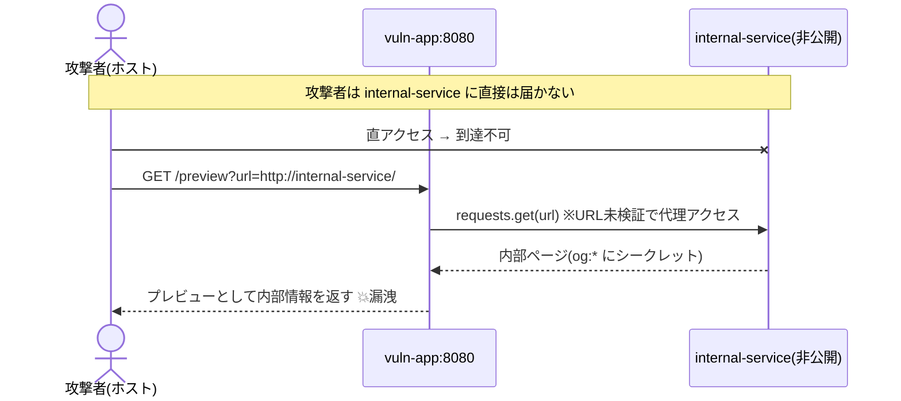
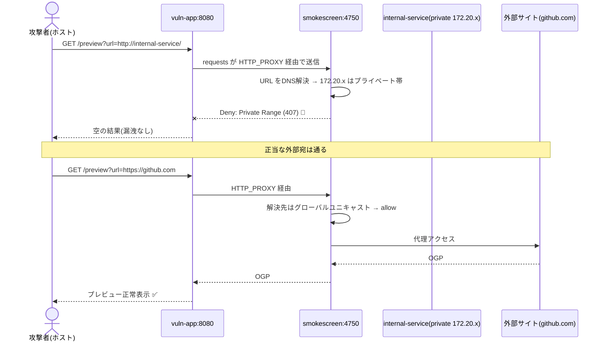

# SSRF ラボ シーケンス図

## ① 対策前（SSRF 成立）



## ② 対策後（Smokescreen が遮断）



## 要点

- 対策前は App が無検証で内部に代理アクセスしてしまう（SSRF の本質）。
- 対策後は App→外部の間に smokescreen が挟まり、DNS 解決後の IP で判定する。
  プライベート/ループバック/リンクローカル帯は Deny、グローバルユニキャストは Allow。
- アプリのコードは変更せず、環境変数 HTTP(S)_PROXY で requests を経由させているだけ。
```
